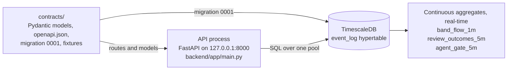

# CheckMate

Check-in plus match. A front-desk intake agent that checks patients in (Spanish or English) behind a deterministic policy gate, and an identity-resolution engine that reconnects a patient's records filed under different identities, requires recorded human approval for every link, and shows the safety fact that was invisible while the records were apart.

Built at HackGB 2026 (UW-Green Bay, October 17 to 18) by a team of two. **Not for clinical use. Synthetic data only.**

## How we used AI

We used coding and research agents; we reviewed, integrated, and evaluated what they produced. This use is disclosed per commit (every commit carries the `[AI-assisted]` tag) and here.

At build time:
- Coding agents built each lane in its own git worktree from a one-page build brief (`CLAUDE.md`, mirrored as `AGENTS.md`) and the lane's spec section.
- A paired adversarial reviewer agent reviewed every lane: it ran the app and the acceptance script, wrote tests meant to fail, and posted PASS or BLOCK on the pull request.
- Codex (read-only sandbox) and GitHub Copilot code review ran on every pull request.
- The evaluation harness ran on every merge to `main` and posts per-band precision and recall with n.
- A human clicked every merge. No agent merges.

At runtime, separately: Gemini runs the intake conversation, language handling and tool arguments. Matching, the policy gate, the allergy rule and the approval are deterministic code or a human decision. No language model sits on the decision path.

All design documents (PRD, architecture, evaluation plan, UX spec) were written before the event and shown to the organizers' rule; every line of code, every migration, and every prompt file in this repository was written after 12:00 CT on 2026-10-17. Confirmed with the organizers at the 11:00 opening.

## How to run

Requires Docker. From the repository root:

```sh
make up
```

`make up` builds and starts the database and the API (`Makefile`, `docker-compose.yml`); the API container applies the migrations before it starts (`backend/Dockerfile`). Then open http://127.0.0.1:8000/api/v1/health and expect `"db":"UP"` (`backend/app/main.py`, `contracts/models/health.py`).

To drop the synthetic database and rebuild it from the seed:

```sh
make down-v
make up
```

Both ports bind to 127.0.0.1 only (`docker-compose.yml`). Routes whose lane has not merged answer `501 NOT_IMPLEMENTED` in the contract's error envelope (`contracts/api_spec.py`).

## Architecture

What exists on `main` today. Components are added to this diagram only when their pull request merges.



| Node | Files |
|---|---|
| contracts | `contracts/README.md`, `contracts/api_spec.py`, `contracts/openapi.json`, `contracts/models/`, `contracts/fixtures/` |
| API process | `backend/app/main.py`, `backend/app/db.py`, `backend/app/config.py` |
| TimescaleDB | `docker-compose.yml`, `contracts/migrations/0001_initial.sql` |
| Continuous aggregates | `contracts/migrations/0001_initial.sql` (`materialized_only = false` on all three) |

## Repository layout

| Directory | Owner lanes (`CLAUDE.md`) | On `main` today |
|---|---|---|
| `contracts/` | lead session | The frozen contract, tag `contracts-v1` (`contracts/README.md`) |
| `backend/` | W1, W2, W3a, W3b and wave 2 | `backend/app/`: health route, error envelope, request id and log line, one database pool |
| `frontend/` | W4 and wave 2 UI lanes | Empty until W4 merges |
| `eval/` | W5, Q2, Q5 | Empty until W5 merges |
| `data/` | W1, W5 | Empty until W1 merges |
| `docs/` | D1, D2, D3 | `docs/LICENSES.md`, `docs/devpost-outline.md` |
| `tools/` | Q15 | Empty |
| `.github/` | W5 | Empty until W5 merges |

## Data provenance

| Source | Use | Terms | Files |
|---|---|---|---|
| Synthea synthetic patients, November 2021 sample | Demo and development records | Apache-2.0 | Raw files are never committed (`.gitignore`: `data/synthea/`) |
| b.well public synthetic patient-matching benchmark, derived from ONC challenge data | Evaluation only, never committed or displayed | Described by the test-set authors as synthetic; terms not located | Never committed (`.gitignore`: `data/onc/`, `data/benchmark/`) |

Third-party code licenses are listed in `docs/LICENSES.md`.

## Not for clinical use

CheckMate is a synthetic-data prototype for identity reconciliation and evidence display. Flags are rule-based, cite their sources, are shown only after a person approves an identity link, and do not direct treatment. Not for clinical use. No clinician has reviewed the rule, the class table or the wording. Absence of a flag does not mean absence of a conflict.

Every flag carries this boundary in its footer (`CARD_FOOTER` in `contracts/models/alerts.py`).

## Known limits and non-goals

- **Synthetic data only.** The database holds only synthetic records and is rebuilt from the seed (`docker-compose.yml`); source datasets are never committed (`.gitignore`).
- **Two sources at the core path:** an ER FHIR record and a clinic CSV row (`contracts/fixtures/scenario.json`).
- **Thresholds come from the synthetic labeled set and are reported with n.** They are evaluation thresholds, not clinical ones. Each threshold set names the run it came from (`sourceRunId`), `isCalibrated` defaults to false, and auto-link is off (`contracts/models/thresholds.py`).
- **No authentication.** A registrar name is a recorded label, not an authenticated identity (`contracts/models/reviews.py`).
- **One process on one laptop, bound to localhost** (`docker-compose.yml`, `Makefile`).
- **The live agent depends on the Gemini API,** with a labeled REPLAY fallback; the API starts in REPLAY (`FRONTDESK_AGENT_MODE` in `docker-compose.yml`, `backend/app/config.py`, `contracts/models/health.py`).
